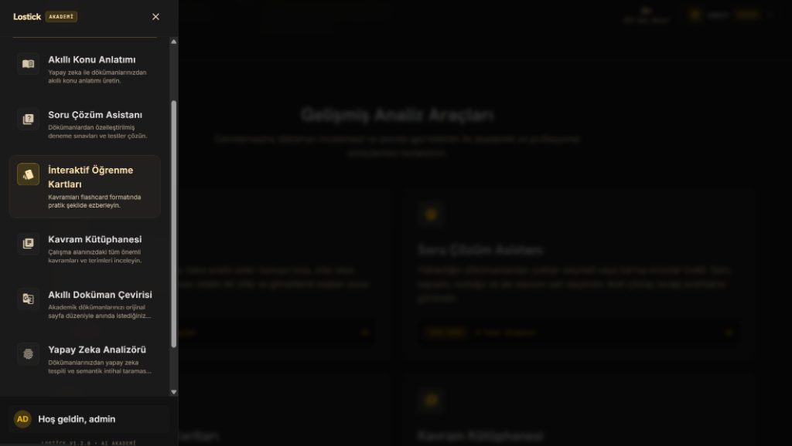
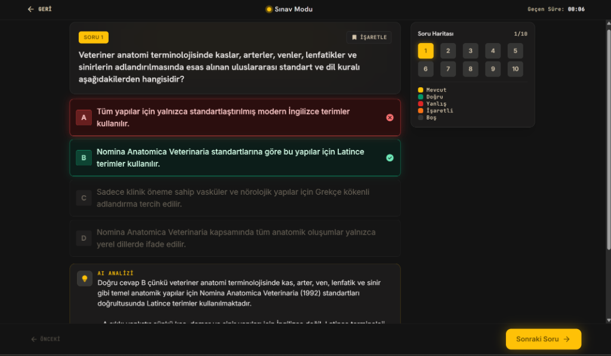
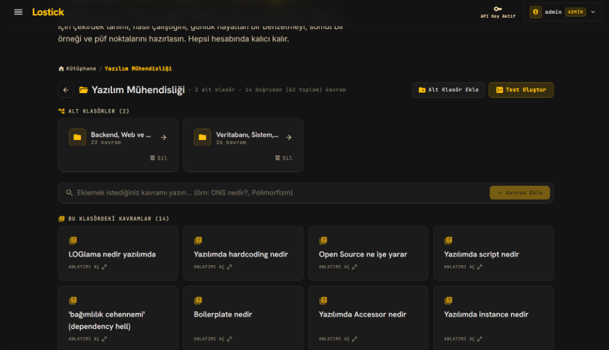
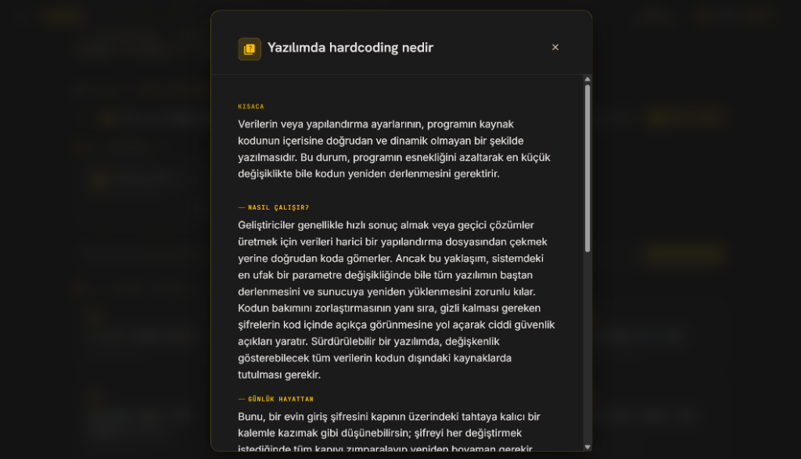
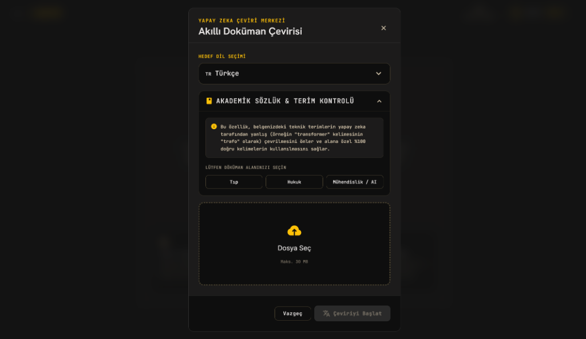

# 🧠 Lostick AI — Yapay Zeka Destekli Akademik Öğrenme, Sınav ve Doküman Analiz Platformu

**Lostick AI (Lostick Akademi)**, öğrencilerin ve araştırmacıların yüklediği akademik PDF, DOCX ve PPTX dokümanlarından **akıllı konu anlatımı**, **özelleştirilmiş deneme sınavları (Soru Çözüm Asistanı)**, **interaktif öğrenme kartları (flashcards)**, **kalıcı kavram kütüphanesi**, **orijinal sayfa düzenini koruyan akademik doküman çevirisi** ve **yapay zeka / semantik intihal analizi** üreten uçtan uca bir yapay zeka platformudur.

---

## 📸 Uygulama Ekran Görüntüleri

### 1. Gelişmiş Analiz Araçları & Akademi Modülleri

### 2. Sınav Modu & Yapay Zeka Çözüm Analizi
Yüklenen dokümanlardan çoktan seçmeli veya karma sınavlar üretir; her sorunun altında doğru ve yanlış şıkların nedenlerini detaylı **AI Analizi** ile açıklar:

### 3. Kavram Kütüphanesi & Klasör Yönetimi
Çalışma alanındaki tüm önemli kavramları ve terimleri alt klasörler halinde organize eder ve tek tıkla klasörden test oluşturur:

| 4. Detaylı Kavram Kartı (Günlük Hayat Benzetmeli) | 5. Akıllı Doküman Çevirisi (Akademik Terim Korumalı) |
| :---: | :---: |
|  |  |

---

## ✨ Temel Modüller

* **📖 Akıllı Konu Anlatımı:** Dokümanları analiz ederek konuyu kısa, orta veya detaylı modda; sade bir dille ve görsellerle baştan sona anlatır.
* **📝 Soru Çözüm Asistanı & Sınav Modu:** Dokümanlardan özelleştirilmiş deneme sınavları, soru haritası ve detaylı AI çözüm açıklamaları üretir.
* **🗂️ İnteraktif Öğrenme Kartları & Kavram Kütüphanesi:** Her kavram için çekirdek tanım, nasıl çalıştığı, günlük hayattan somut benzetme ve püf noktaları hazırlar.
* **🌐 Akıllı Doküman Çevirisi (Akademik Sözlük & Terim Kontrolü):** Tıp, Hukuk ve Mühendislik/AI alanlarına özel terminoloji koruması ile teknik terimleri yanlış çevirmeden (ör. *transformer* terimini *trafo* yapmadan) orijinal sayfa düzeniyle çevirir.
* **🔍 Yapay Zeka Analizörü:** Dokümanlarda yapay zeka tespiti ve semantik intihal taraması gerçekleştirir.

---

## 🏗️ Mimari

| Katman | Teknoloji |
|---|---|
| **Backend API** | FastAPI + Uvicorn |
| **LLM & RAG** | Google Gemini (google-genai, langchain-google-genai) + FAISS / Chroma + FastEmbed |
| **Belge İşleme** | PyMuPDF, pypdf, python-docx, python-pptx, ReportLab |
| **Veritabanı & Kuyruk** | PostgreSQL (Üretim) · SQLite (Geliştirme) + Redis RQ Worker |
| **Kimlik Doğrulama** | Google & GitHub OAuth2 + E-posta Doğrulama + BYOK (Bring Your Own Key) |
| **Frontend** | Next.js + Tailwind CSS (landing/) |

---

## 🚀 Kurulum

### Backend
`ash
python -m venv venv
venv\\Scripts\\activate        # Windows
pip install -r requirements.txt

copy .env.example .env
uvicorn main:app --reload
`

### Frontend (landing/)
`ash
cd landing
npm install
npm run dev
`

---

## 👨‍💻 Geliştirici
**Eren Sezer** — [GitHub Profilim](https://github.com/erensezer07-gif)
