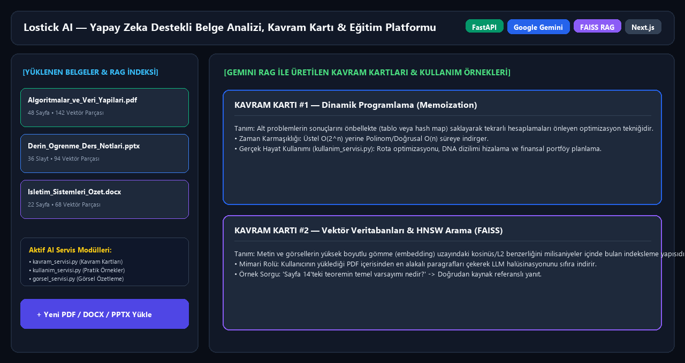
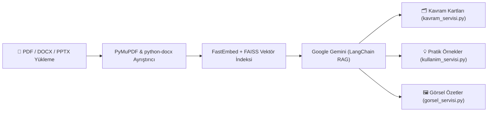

# 🧠 Lostick AI — Yapay Zeka Destekli Belge Analizi, Kavram Kartı ve Eğitim Platformu


**Lostick AI**, öğrencilerin ve araştırmacıların yüklediği PDF, DOCX ve PPTX ders notlarından/belgelerinden otomatik olarak **konu anlatımı**, **kavram kartları (flashcards)**, **görsel özetler** ve **gerçek hayat kullanım örnekleri** üreten RAG (Retrieval-Augmented Generation) tabanlı bir eğitim platformudur.



---

## 🏗️ RAG ve Belge İşleme Mimarisi



| Katman | Teknoloji |
|---|---|
| **Backend API** | FastAPI + Uvicorn |
| **Yapay Zeka / LLM** | Google Gemini (`google-genai`, `langchain-google-genai`) — BYOK (Bring Your Own Key) destekli |
| **Vektör Arama (RAG)** | FAISS / Chroma + FastEmbed |
| **Belge İşleme** | PyMuPDF, pypdf, python-docx, python-pptx, ReportLab |
| **Veritabanı & Kuyruk** | PostgreSQL (Üretim) / SQLite (Geliştirme) + Redis RQ Worker |
| **Kimlik Doğrulama** | Google & GitHub OAuth2 + PBKDF2 Oturum Yönetimi + E-posta Doğrulama |
| **Frontend** | Next.js + Tailwind CSS (`landing/`) |

---

## 🔒 Güvenlik Mimarisi (BYOK — Bring Your Own Key)

* Uygulama **BYOK** modunda çalışacak şekilde tasarlanmıştır: her kullanıcı kendi Gemini API anahtarını arayüz üzerinden güvenli şekilde kullanabilir.
* Varsayılan yönetici hesabı kaynak kodda sabit şifre barındırmaz; ilk başlatmada `secrets.token_urlsafe` ile kriptografik rastgele şifre üretilir.
* Tüm hassas yapılandırmalar `.env` üzerinden yönetilir ve sürüm kontrolüne dahil edilmez.

---

## 🚀 Kurulum ve Çalıştırma

### 1. FastAPI Backend
```bash
python -m venv venv
venv\Scripts\activate        # Linux/macOS: source venv/bin/activate
pip install -r requirements.txt

cp .env.example .env         # Windows: copy .env.example .env
uvicorn main:app --reload
```

### 2. Next.js Frontend (`landing/`)
```bash
cd landing
npm install
npm run dev
```

---

## 👨‍💻 Geliştirici
**Eren Sezer** — [GitHub Profilim](https://github.com/erensezer07-gif)
